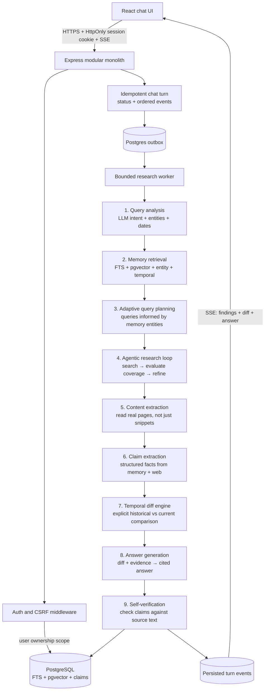

# Minimi Research Agent — Design

## What it is

Minimi is a **temporal research agent**: it retrieves structured claims from conversation memory, iteratively searches the web for current evidence, runs an explicit diff between past and present, and generates a cited, verified answer.

## How it works

### 1. Query analysis
The LLM classifies the message: does it need memory (past conversations), web (current facts), or both? It also extracts named entities and generates initial search queries. A regex router provides a fast fallback when the LLM is unavailable.

### 2. Memory retrieval
Hybrid retrieval combines PostgreSQL full-text search, Gemini embeddings with pgvector cosine distance, and explicit entity mentions. Temporal parsing converts date expressions ("on Monday", "last Tuesday", "last week", "3 days ago") to date ranges that filter memory chunks. Results are fused with reciprocal rank fusion (RRF).

### 3. Adaptive query planning
Search queries are generated **after** memory retrieval, not before. If the user asks "has any of them changed pricing?" referring to 5 CRM tools discussed last Monday, the agent first retrieves those tools from memory, then generates entity-specific search queries for each one. This is the key to answering referential questions — you can't search for "them" until you know who "them" is.

### 4. Agentic research loop
Instead of a single batch of search queries, the agent iterates:
- **Round 1**: Search with planned queries → extract content from top results → evaluate coverage
- **Round 2** (if gaps found): Search with refined queries for missing entities → re-evaluate
- Bounded by `MAX_SEARCH_ROUNDS` (default 2) and `RESEARCH_BUDGET_MS` (default 45s)

The LLM evaluates "do I have enough evidence for each entity?" between rounds. This transforms the agent from "search + summarize" to "research agent."

### 5. Content extraction
Search snippets are too shallow for pricing comparisons. The agent fetches and reads full page content for the top 3 most relevant results, converts HTML to text, and truncates to a token budget. Tavily's `include_raw_content` is used when available; pages are fetched directly as a fallback.

### 6. Structured claim extraction
The agent extracts structured claims from both memory and web results: `{ entity: "HubSpot", attribute: "price", value: "$20/mo", date: "2026-11-03" }`. An LLM-based extractor provides accuracy; a regex-based extractor provides a fast fallback. Claims are extracted in parallel from both sources.

### 7. Temporal diff engine
Claims from memory (historical) and web (current) are matched by normalized entity + attribute, then compared:
- **Changed**: historical value differs from current value
- **Unchanged**: values match (handles format variations like "$20/mo" vs "$20/month")
- **New finding**: present in web but not in history
- **No current evidence**: present in history but not found in web

The diff is fed to the LLM as structured input, not raw text. The LLM's job becomes "write a clear answer from this comparison" rather than "figure out what changed by reading thousands of tokens."

### 8. Answer generation
Gemini generates the answer with the structured diff as input alongside raw memory and sources. If Gemini models are unavailable or rate-limited, a provider cooldown suppresses repeated calls and the answer router can use Groq. Output token limit is configurable (default 2048, up from 1200) to accommodate complex comparisons. The server buffers a provider response before sending answer deltas so a failed partial response is never combined with a second provider's answer.

### 9. Self-verification
After the answer is generated, each (claim, citation) pair is checked against the cited source's text. The verifier extracts claim-citation pairs from the answer, then checks keyword overlap and price matching between each claim and its cited source. Unsupported claims are flagged with a user-facing notice. Structured claims now persist with tenant, conversation, message/source provenance, and a stable evidence key.

### 10. Durable turns and indexing

The API creates a `ChatTurn` and `chat.run` outbox event in one transaction. A database worker claims work with `FOR UPDATE SKIP LOCKED`, executes research, and persists ordered `ChatTurnEvent` rows. SSE reads those rows, so a client can reconnect using the idempotency key and last event sequence. Completed assistant messages enqueue `memory.index` in the same transaction; that worker retries chunk, embedding, mention, and rolling-summary updates independently of the user request.

## Why we built it this way

**Bounded agentic loop over open-ended tool calling.** Open-ended tool calling (let the LLM decide what to do next) is unpredictable and can spiral. A bounded loop with explicit coverage evaluation gives the same research depth with predictable latency and safety guarantees. The loop is capped at 2-3 rounds, each round has its own query budget, and the total is bounded by the research time budget.

**Structured claims over free-text comparison.** Asking the LLM to implicitly compare free-text memory against free-text web results is a coin flip. Extracting structured claims and running an explicit diff makes the comparison auditable, verifiable, and displayable in the UI. The `ResearchClaim` table in the schema was designed for this.

**Adaptive queries over fixed queries.** Generating search queries before memory retrieval fails on referential questions ("has any of *them* changed?"). Memory informs the search: you learn what entities were discussed, then search for each one specifically.

**Content extraction over snippets only.** Pricing pages have tables, plan names, and feature matrices. A 200-character snippet can't capture "$20/mo for Starter, $500/mo for Enterprise." Reading the actual page gives the agent the depth it needs for accurate comparison.

**Self-verification over blind trust.** Citation ID validation checks that `[S1]` exists. It doesn't check that the claim attached to `[S1]` is actually in the source. A hallucinated price with a real citation ID passes ID validation but fails content verification. The verifier catches this.

**Progressive streaming over silent waiting.** The user sees what the agent is doing at each step: which conversations it found, what it's searching for, whether coverage is sufficient, and the final diff. This makes the agent feel transparent and trustworthy.

## What we considered and rejected

**Open-ended tool calling** (let the LLM decide which tool to call and when). Rejected for unpredictability: the LLM can call tools in a loop, call the wrong tool, or never converge. The bounded loop gives the same depth with predictable latency.

**Full page crawling for all results.** Rejected for latency: fetching 20 pages adds 10-20 seconds. Instead, we extract content only from the top 3 most relevant results, which gives depth where it matters most.

**Persisting web claims to ResearchClaim.** Considered but deferred: web claims are transient (valid at query time), while memory claims are durable. Persisting web claims would require timestamp tracking and cleanup. The diff engine works on transient claims for both sources.

**Cross-encoder re-ranking of memory chunks.** Considered for precision but rejected for latency: adding a cross-encoder model call adds 1-2 seconds. RRF already provides good ranking for the current scale.

**WebSocket over SSE.** Considered for bidirectional communication (cancel, regenerate) but SSE is simpler and sufficient for the current streaming model. WebSocket would help for real-time cancellation but adds complexity.

## Database design

PostgreSQL stores authoritative messages, conversation metadata, sources, entities, claims, chat turns/events, outbox work, and memory chunks. pgvector keeps embeddings beside relational data for a single Neon deployment. Hybrid retrieval combines indexed full-text search over messages and chunks, semantic cosine distance, persisted claims, extractive conversation summaries, and entity mentions with RRF. Derived memory work is retryable through the outbox.

## Temporal behavior

Date parsing uses the configured IANA timezone and converts supported expressions to date ranges before ranking. "On Monday" resolves to the most recent past Monday. "Last Tuesday" resolves to the most recent past Tuesday. "Last week" gives a 7-day range; "last month" gives the previous calendar month. "N days ago" and "a week ago" resolve to the exact date. An explicit month/day without a year is marked ambiguous and uses the nearest past occurrence. Stored message timestamps are the record time; source publication dates are not treated as change dates.

## Resilience

Search calls run with bounded query count and concurrency; transient errors use capped retries with jitter and honor `Retry-After`. Search failures preserve successful results and are disclosed. Gemini uses configurable thinking for interactive latency and bounded per-model attempts with stable fallback models. LLM failure returns a controlled error after preserving the user message. Database retrieval failures never become claimed memories. Timeouts use abort signals. The research budget caps total wall-clock time across all rounds.

## Scaling

The service is stateless and uses a pooled Prisma client. Database, memory, and context limits are configurable. Horizontal scaling requires a shared PostgreSQL database and consistent environment configuration. Redis (Upstash) provides a shared atomic rate limit across instances with a process-local fallback.

## What we'd do with another week

- **Activate ResearchClaim persistence**: store extracted claims durably so we don't re-extract on every query. Index by entity + attribute for fast lookup.
- **Activate ConversationSummary**: rolling summaries for long conversations, reducing token cost and improving retrieval.
- **Source credibility ranking**: prioritize official/pricing pages over blogs using domain authority signals.
- **LLM-based verification**: use a second LLM call to verify claim content against source text, beyond the current keyword-overlap heuristic.
- **Token budget management**: count tokens before sending to the LLM, prioritize most relevant content, truncate intelligently.
- **Date clarification prompts**: when `ambiguousYear` is true, surface it in the UI and ask the user for clarification before answering.
- **Password recovery and verification**: secure recovery and verified email flows before broad public signup.
- **Batched embeddings**: use Gemini's batch embedding API instead of sequential calls.
- **Cross-conversation temporal correlation**: "what did we discuss around the same time as the Postgres conversation?"

## Production architecture and security

Keep the application as a **modular monolith** until traffic or team ownership requires independent scaling. Chat orchestration, authentication, retrieval, temporal comparison, and provider routing have module boundaries but share one deployment and PostgreSQL source of truth. This avoids premature service-to-service latency and keeps transactions understandable.

### Identity and browser security

- Signup and login use email plus scrypt password hashes. The browser receives a random opaque session token in an `HttpOnly`, `Secure` (production), `SameSite` cookie. Only its SHA-256 hash is stored in PostgreSQL; logout revokes it and expiry is checked on each request.
- The client never stores credentials in local storage or embeds a server token in its build. Mutating requests must carry an allowed `Origin`; CORS is allow-listed and credentialed. Use HTTPS from browser to trusted edge and API. Prefer same-site app/API hosts or a same-origin reverse proxy; third-party cookie behavior is not reliable.
- Every conversation read, write, delete, and memory retrieval is scoped to the authenticated user. IDs are not authorization: a guessed ID for another account returns not found.
- Request rate limiting runs before JSON parsing. Redis-compatible shared counters are recommended across replicas. Password reset, verified email, MFA, and abuse detection are follow-up requirements before opening self-service signup broadly.

### Provider resilience

Gemini remains primary for generation and embeddings. Gemini model fallback handles per-model capacity; a provider cooldown avoids repeatedly spending calls after a 429. Groq can generate the final answer when Gemini is unavailable. Embeddings remain Gemini-dependent and gracefully fall back to keyword retrieval; Groq does not cover database, search, or embedding outages.

The cooldown is currently process-local. Before scaling the API horizontally, store circuit state in Redis (provider key, open-until timestamp, failure count) and use atomic updates. Record provider/model, status, duration, token usage, and request ID, but do not log prompts, passwords, cookies, or session tokens. Alert on sustained rate limits and provider spend.

### Data and work scaling

PostgreSQL is authoritative for identity and conversation history. Memory chunks, vectors, and full-text vectors are derived and can be rebuilt. Apply schema changes through additive migrations, back up hosted data, and verify restore procedures. Keep pgvector and full-text retrieval bounded by per-user scope and result limits.

Research is now queued durably and SSE subscribes to persisted turn events. Keep separate limits for concurrent jobs, per-user queue depth, search rounds, extraction count, context tokens, output tokens, and wall time. Production deployments still need queue-depth alerts, worker autoscaling based on backlog, event retention policies, and database backup/restore drills.
