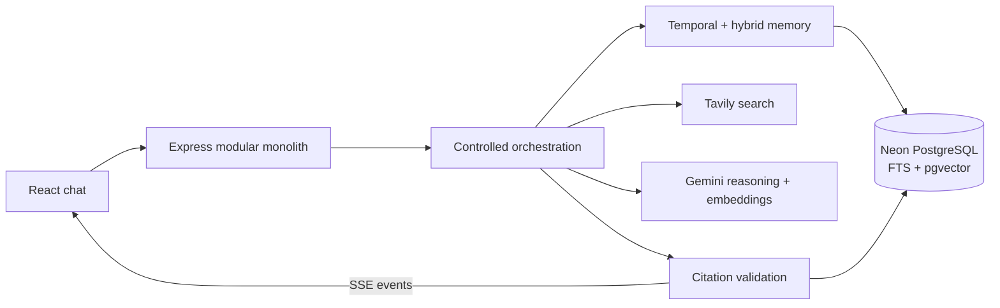

# Minimi Research Agent — Design

The system is a modular monolith: chat, orchestration, temporal parsing, hybrid retrieval, search, citation validation, provider adapters and persistence are separate modules deployed as one stateless Node service. This keeps local operation and deployment simple while retaining clear extraction seams.

PostgreSQL stores authoritative messages, conversation metadata, sources and entities. pgvector keeps embeddings beside relational data and supports a single Neon deployment. Hybrid retrieval combines PostgreSQL full-text ranking, semantic cosine distance and explicit entity mentions with reciprocal rank fusion; keyword matching is important for exact products and provider names that vector similarity may blur.

Temporal parsing uses the configured IANA timezone and converts supported expressions to date ranges before ranking. An explicit month/day without a year is marked ambiguous and currently uses the nearest past occurrence; the API/UI should surface that ambiguity before treating it as certain. Stored message timestamps are the record time; source publication dates are not treated as change dates.

Tavily is the sole external research tool. Search results are normalized, URL-deduplicated, time-stamped and cited by stable per-answer IDs. Gemini receives only retrieved history and returned sources, compares those evidence sets, and is instructed to distinguish missing, conflicting and unverifiable facts. The server checks every citation ID before returning the answer.

Search calls run with bounded query count and concurrency; transient errors use capped retries with jitter and honor `Retry-After`. Search failures preserve successful results and are disclosed. Gemini uses configurable low thinking for interactive latency and bounded per-model attempts with stable fallback models when a primary model is overloaded. LLM failure returns a controlled error after preserving the user message. Database retrieval failures never become claimed memories. Timeouts use abort signals.

The initial service is stateless and uses a pooled Prisma client suitable for Neon’s pooled connection URL. Database, memory and context limits are configurable; no cache or queue is added. Horizontal scaling requires only a shared PostgreSQL database and consistent environment configuration. Future work: per-user authentication/isolation, robust natural-language date clarification, batched embeddings, explicit token/usage telemetry, and a browser-readable citation validation UI. Free-tier allowances can change; verify current Neon limits before deployment.
